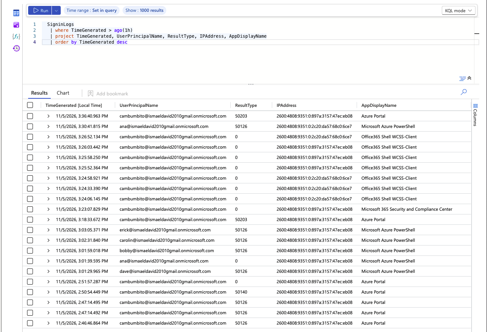

# Entra ID: Sentinel Detection Engineering Lab

## Architecture

Cloud-identity detection pipeline, all in Azure:

Attacker (Kali) → Entra ID tenant → Entra diagnostic settings →
Log Analytics workspace (`<sentinel-logger>`) → Microsoft Sentinel → KQL analytics rules → Incidents

- **Entra ID** — identity provider and attack surface; emits SigninLogs + AuditLogs.
- **Entra data connector / diagnostic settings** — forwards those logs to the workspace.
- **Log Analytics workspace** (`sentinel-logger`) — stores the log tables KQL queries.
- **Microsoft Sentinel** — the SIEM layer; analytics rules run KQL on a schedule and raise incidents.
- Region: `East US`.

**Pipeline verified before any attack:** a test sign-in was generated and confirmed to
appear in `SigninLogs` in Sentinel, proving end-to-end ingestion works. Evidence:

