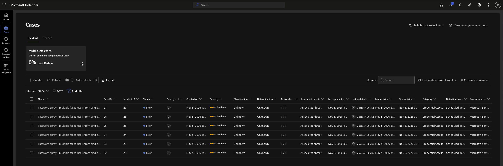
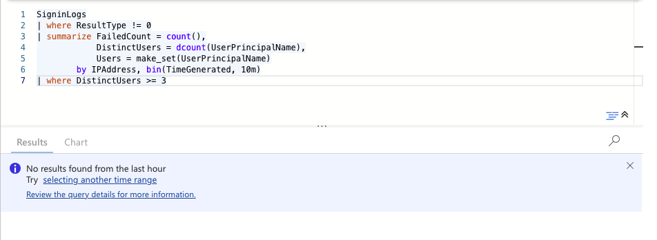
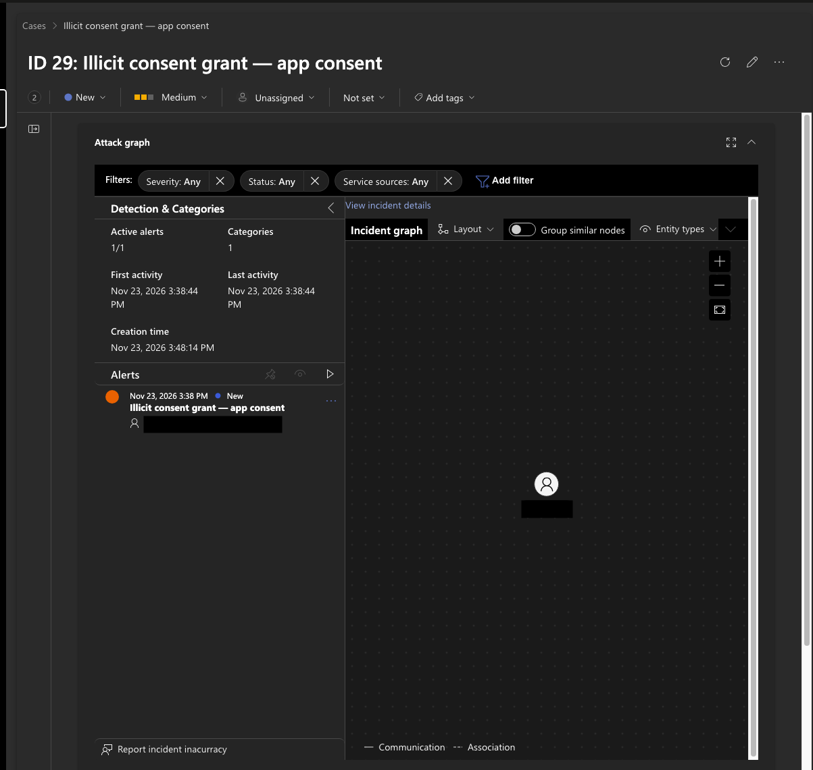
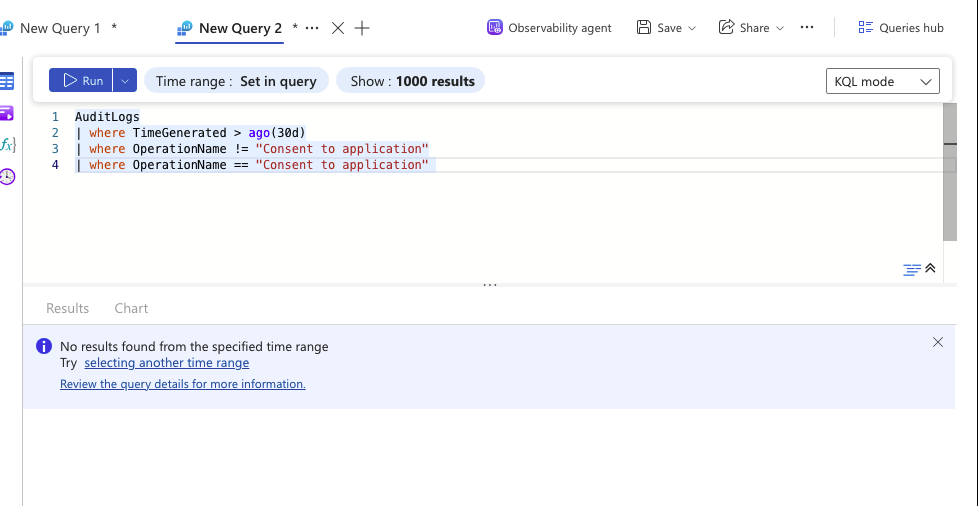

# Entra ID: Sentinel Detection Engineering Lab

## Architecture

Cloud-identity detection pipeline, all in Azure, where we capture 2 incidents using different data sources (SignInLogs & AuditLogs):

Attacker (Kali) → Entra ID tenant → Entra diagnostic settings →
Log Analytics workspace (`sentinel-logger`) → Microsoft Sentinel → KQL analytics rules → Incidents

- **Entra ID** — identity provider and attack surface; provides SigninLogs + AuditLogs.
- **Entra data connector / diagnostic settings** — forwards those logs to the workspace.
- **Log Analytics workspace** (`sentinel-logger`) — stores the log tables KQL queries.
- **Microsoft Sentinel** — the SIEM layer; analytics rules run KQL on a schedule and raise incidents.
- Region: `East US`.

**Pipeline verified before any attack:** a test sign-in was generated and confirmed to
appear in `SigninLogs` in Sentinel, proving end-to-end ingestion works. Evidence:


## Setup

1. Log Analytics workspace `sentinel-logger` in region `East US`, resource group `sentinel-lab`.
2. Microsoft Sentinel enabled on that workspace (free trial available).
3. Entra data connector enabled → SigninLogs + AuditLogs → the workspace.
   (Under the hood: Entra ID → Diagnostic settings → send to Log Analytics.)
4. 5 test users created (P2-licensed): `ana`, `bobby`, `carolin`, `dave`, `erick`.
5. Verified: test sign-in appeared in SigninLogs (see screenshot above).

## Detection 1 — Password Spray (MITRE ATT&CK T1110.003)

**The attack.** A password spray tries a few common passwords across many accounts to evade
per-account lockout. Simulated here via scripted authentication attempts against the Entra
token endpoint, across 5 test users (`attacks/password-spray.sh`), producing failed sign-ins
(`ResultType 50126`) in `SigninLogs`.

**The signal.** Many distinct users failing authentication from a single source in a short
window:

​```kusto
SigninLogs
| where ResultType != 0
| summarize FailedCount = count(),
            DistinctUsers = dcount(UserPrincipalName),
            Users = make_set(UserPrincipalName)
        by IPAddress, bin(TimeGenerated, 10m)
| where DistinctUsers >= 3```


**The detection.** A scheduled Sentinel analytics rule on the query above (full rule in
`detections/password-spray.kql`), mapped to T1110.003. Triggers when ≥3 distinct users fail
from one source in a 10-minute bin.

> **Note:** the rule's lookback window is set in the rule *configuration*, not the query —
> which is why there's no `ago()` in the committed KQL.

**Validation.**

| Test | Input | Expected | Result |
|---|---|---|---|
| Positive | spray (≥3 users fail, one source) | incident fires | |
| Negative | single failed login (1 user) | no incident | 0 rows - no incident  |

The **negative test** is the important half: a single failed login logged in `SigninLogs`
(1 user) but returned **zero rows** against the rule query — the `≥3` threshold held, so no
incident fired. The detection discriminates a benign fat-fingered password from an actual
spray.


## Detection 2 — Illicit Consent Grant (MITRE ATT&CK T1528)

**The attack:** An illicit consent grant tricks a victim into consenting to a malicious
OAuth app, giving the app a token to the user's data — no password needed, and MFA doesn't
help, because the user authenticates legitimately and then authorizes the app. A registered
test app (`legit-app`) requesting delegated Graph permissions was consented to; the grant
produces a **"Consent to application"** event in `AuditLogs`.

**The signal.** A successful app-consent event:

​```kql
AuditLogs
| where OperationName == "Consent to application"
| where Result == "success"
| extend AppName = tostring(TargetResources[0].displayName)
| project TimeGenerated, OperationName, AppName,
          InitiatedBy = tostring(parse_json(InitiatedBy).user.userPrincipalName)```

**The detection.** A scheduled Sentinel analytics rule on the query above (full rule in
`detections/consent-grant.kql`), mapped to T1528. Runs every 5 min, 1-hour lookback.
`InitiatedBy` is mapped to an Account entity, so incidents show who granted the consent.

**Validation.**

| Test | Input | Expected | Result |
|---|---|---|---|
| Positive | app consent granted | incident fires |  |
| Negative (logic) | any non-consent audit event | no match |  |

The incident correctly surfaced the granting account as an entity. The negative test is a
logic check: the rule's filter matches **only** `Consent to application`, so unrelated audit
activity doesn't interfere.


## Finding — layered consent controls block the user-consent attack path

Attempting the classic user-consent illicit grant surfaced **three stacked controls** that
blocked it, by default:
1. **User consent restricted** — users got "admin approval required," not a consent prompt.
2. **Permission classification** — enabling user consent only allows permissions explicitly
   classified "low impact" (an empty list by default).
3. **Admin-consent-required scopes** — high-value permissions (Mail.Read, Files.Read.All)
   require admin consent regardless of the above.

The consent only succeeded via the **admin-consent path** — i.e. an admin granting it. This
is exactly why real consent-phishing campaigns target **admins**: user consent is locked down
by default, so the realistic attack vector is tricking a privileged account into granting
consent. The detection keys on the consent event itself, so it covers the admin-consent path
that a hardened tenant actually exposes.

### Why MFA doesn't address this

The attack abuses **authorization**, not **authentication** — two different control planes:

1. Victim clicks a consent link (phishing) and **signs in normally — passing MFA.** This is a
   legitimate authentication to their own account; MFA does its job.
2. Victim sees a consent prompt ("this app wants to read your mail / maintain access") and
   clicks **Accept** — authorizing the app.
3. The app receives an OAuth **token** (with `offline_access`, a persistent refresh token) and
   accesses the victim's data via Microsoft Graph **from the attacker's infrastructure, using
   the token — never re-authenticating.**

MFA secures step 1 (proving who signed in). The compromise is at step 2 (what the
authenticated user consented to) — a plane MFA has no say over. No second login occurs for MFA
to challenge; the app just uses its token.

In this tenant, user consent was blocked by default, so the viable path was **admin consent** —
and that is *more* dangerous: an admin can grant an app **tenant-wide** data access (all users'
mail/files), not just their own. A bigger blast radius is why consent-phishing targets privileged
accounts. **Detection — not MFA — is the control that catches this.**
