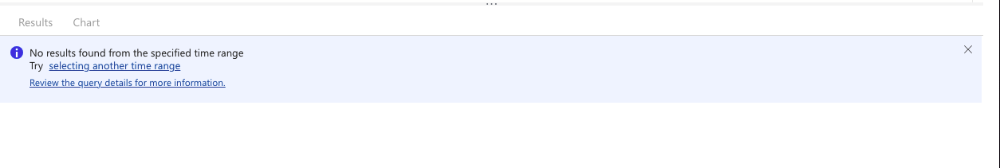

# Troubleshooting notes

## M1 — Sentinel + Entra connector setup

### Region restriction on resource creation
- **Symptom:** creating the Log Analytics workspace failed with
  `RequestDisallowedByAzure` — "This policy maintains a set of best available regions
  where your subscription can deploy resources."
- **Cause:** the subscription (student/sponsored tier) is restricted to a subset of
  Azure regions.
- **Fix:** deployed to `<allowed-region>` from the subscription's permitted set (the
  Create blade's region dropdown shows the allowed list). Contacting support is unnecessary
  for a lab — any allowed region works.
- **Lesson:** keep ALL lab resources in that one allowed region (workspace, Sentinel,
  later the Logic App) to avoid cross-region errors/costs.

### Entra → Sentinel ingestion lag
- **Symptom:** 

The logs-flowing query returned empty immediately after
  the test sign-in.
- **Cause:** Entra→Log Analytics ingestion has ~5–15 min lag; empty at 2 min is normal.
- **Fix:** waited out the lag before concluding the connector was misconfigured.
- **Lesson:** an empty query ≠ a broken pipeline; confirm timing before debugging config.
